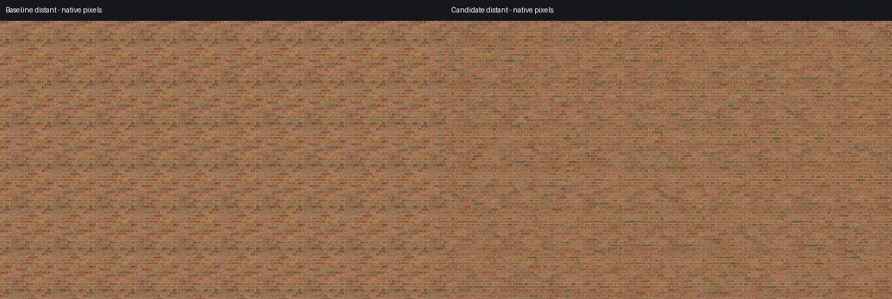

# Brick palette mode: results and limits

The accepted **Brick 4 4×4 palette mode** reduces the repeated colored patches while retaining sharp, aligned mortar in the inspected views. It stays opt-in. **The attempted atlas-size reduction did not meet every quality check**, so the quality default remains 4×4: about **85.3 MiB of theoretical uncompressed RGBA8 texels including mipmaps per atlas**. This is not measured physical VRAM or process allocation.

Left: original v0.7.0. Right: accepted Brick 4 palette mode. These stored native crops are not resized.

Source-repeat color correlation falls 56.7% / 59.2% in the two accepted distant seed cases. Original joint geometry, fine weathering and some dark protected rims still repeat. Protected rendered mortar RGB stays within 1/255; protected normal/roughness match exactly in the tested views. Local neighboring-feature contrast can change substantially. [Accepted quality, native tail review and matched motion](../individual_brick/README.md) describe those limits; current N=4 compatibility controls match the complete accepted shader with zero observed framebuffer byte difference.

## Size and rendering outcomes

| Prepared layout | Theoretical RGBA8 mip texels | Outcome |
| --- | ---: | --- |
| Accepted 4×4 | 85.3 MiB | Retained quality default |
| Initial random 2×2 | 21.3 MiB | Multiple quality degradations |
| Balanced 2×2 | 21.3 MiB | Color improves; one intermediate luminance condition fails |
| Balanced 3×3 | 48.0 MiB | Same intermediate luminance condition fails; no user preset |

Balanced 2×2 remains an explicit memory/quality tradeoff, not an equivalent replacement. At intermediate seed 7, its luminance-correlation ratio is 0.673 versus 0.526 for accepted 4×4; 3×3 is 0.661. Both exceed the predeclared +0.05 allowance. No gate was waived and no native source tile was downscaled. [Full gate results, failed trials and isolated memory measurements](STAGE1.md) retain every case. Engine texture accounting matches the theoretical texel sums; it is not a residency measurement. Two loaded 4×4 textures contain about 170.7 MiB of texels, regardless of which sampler is bound.

On Apple M5 / Godot 4.7.2 Compatibility, matched CPU render-call intervals were:

| Scene | v0.7.0, ms | Accepted 4×4, ms | Compact balanced 2×2, ms |
| --- | ---: | ---: | ---: |
| Close wall | 0.920 (0.920–0.921) | 0.719 (0.718–0.755) | 0.748 (0.703–0.749) |
| Distant wall | 0.742 (0.732–0.746) | 1.019 (1.016–1.031) | 1.020 (1.018–1.021) |
| Sphere | 1.003 (0.995–1.073) | 0.849 (0.840–0.945) | 0.703 (0.698–0.737) |

Values are median of three round medians; parentheses show their range. The timer surrounds only synchronous `RenderingServer.force_draw(false)` calls, with yields outside four-draw batches, 90 warmups and 240 measured draws per arm/round. All 6,480 measured draws had post-draw/drawcall evidence. These CPU intervals can include driver and GPU queue backpressure; GPU timer samples were zero. They are not GPU duration, whole-frame latency or FPS, and are not comparable with differently scheduled historical tests. **The accepted mode is slower in the tested distant wall**, despite shorter calls in the other workloads. See [protocol and raw rounds](STAGE1.md#finite-render-call-experiment).

## Sources, meshes and controls

The demo has 19 CC0 source sets, but **Brick 4 is the qualified palette preset**. Red Brick and Large Red Bricks are controlled authoring examples with `supported=false`; their palette controls stay disabled. Their colors improve, but both miss the luminance target and Red Brick also narrowly misses palette retention. [Source/mask recipes](materials/SOURCES.md), [all material and mesh outcomes](STAGE2.md), and their native comparisons remain available. This is not automatic brick recognition.

For the accepted mode, choose **Brick 4 → Mesh: Wall**, enable **Preserve pattern** and **Protect mortar**, keep detiling on, then enable **Vary individual brick colors**. The demo binds palette 0; the alternate palette 7 is exercised explicitly by the evaluator. The variation seed changes the stochastic world layout. The prior macro-tone comparison remains labeled experimental and is temporarily disabled by the palette mode. Blend controls that do not affect this route are disabled. Original defaults and material indices 0–16 remain intact.

Terrain, Wall, Box/corner and Cylinder are selectable with appropriate views; controls scroll at 1280×720 and 800×600. [Default-size UI](ui-1280-top.png) and [smaller UI](ui-800-bottom.png) show actual rendered state. Corner/cylinder captures preserve each projection's phase but do not establish continuous brick courses around arbitrary geometry. Triplanar blend bands and repeated source details remain limitations; Wall is the recommended brick starting point.

The new `brick_individual_tiles_per_axis` uniform defaults to 4 for compatibility. It scales atlas UVs, gradients and integer source-offset range; it does not change native source resolution. The aligned stochastic route uses fifteen source-level full-PBR reads when resolved, at most sixteen with one coarse mean read; counts are not timing estimates. See [generic authoring and import settings](AUTHORING.md), [prepared assets and licenses](materials/SOURCES.md), and [media provenance](media-provenance.json).

The [v0.8.0 release](https://github.com/gothicpixie/godot-hex-detiling/releases/tag/v0.8.0) addon archive contains only the ten MIT addon files, including the shader helper and three UID sidecars. CC0 examples, masks, atlases, generation tools and comparison media belong to the full project. Archive import/runtime checks and the verified file manifest are recorded in [validation](VALIDATION.md) and [package metadata](package.json); package preparation alone does not publish a release.
