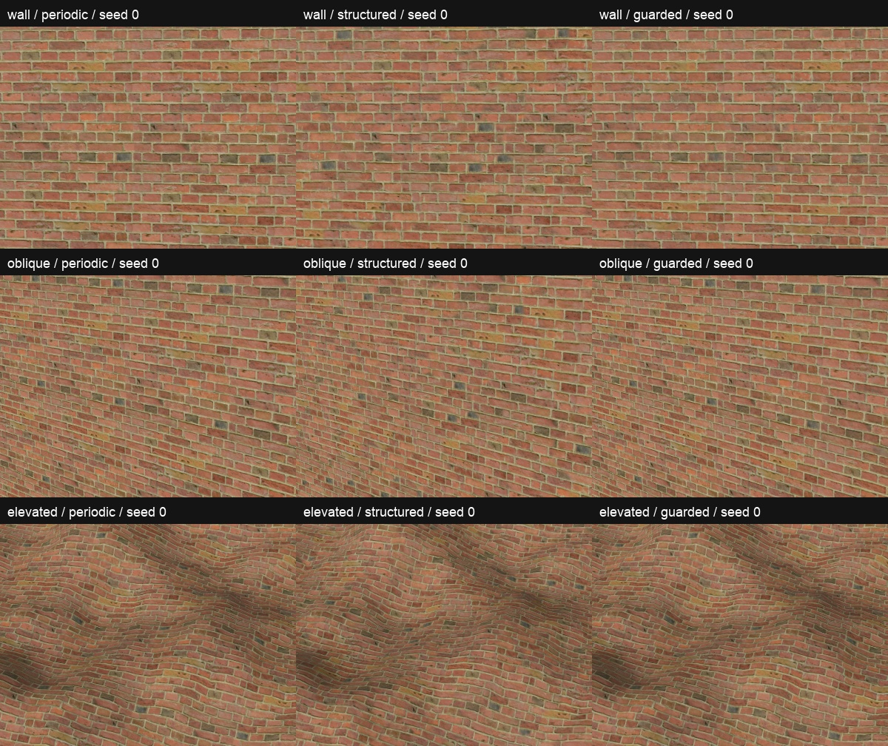

# Optional Brick 4 mortar protection

The approximate brick lattice can blend shifted irregular joints into soft or doubled mortar. The separate **Protect mortar** option retains the original source around its joints while allowing safe brick interiors to vary. It is a source-specific guard, not new brick synthesis or automatic pattern recognition.

In the demo, select **Brick 4**, then enable **Preserve pattern**. Protect mortar is initially checked; uncheck it to compare against the earlier structure mode. Its preference persists across source changes, but its shader activation and mask are cleared outside supported brick use. While it is active, the blend selector is disabled with “Protect mortar uses coherent blending”; disabling the guard restores the prior blend choice. Wood and paving retain their existing behavior.

The panels use identical native 400 × 300 crops without resizing. In the tested views the guarded mortar follows the original source more closely than the existing approximate-lattice blend, while interior tones vary. Repetition remains visible. See [seed 7](native-comparison-seed7.jpg), the [original PNG captures and settings](capture-settings.json), and the [validation record](VALIDATION.md). The direct near-source probe at the real brick preset recorded zero observed RGBA8 error on 14,492 sampled mask-black pixels and mean color L2 difference 0.104976 on 16,648 mask-white pixels. This quantized result is not a floating-point exactness claim or a proof that every mortar pixel is correctly masked. These are fixed examples, not a guarantee for arbitrary scales, lighting, renderers, or geometry.

## Mask and shared material weights

The [source-aligned mask](source-mask.md) derives from the matching CC0 Brick 4 displacement by Rob Tuytel / Poly Haven. It protects the irregular mortar with a wrapped conservative distance band and smooth feather; existing source PBR textures are unmodified. [Provenance and hashes](source-mask.json) record its input and generation parameters. The mask is linear data: black protects the original sample and white permits interior variation. It has 40.54% fully protected pixels and 46.29% fully eligible pixels; the conservative band intentionally limits variation.

For each projection, the shader retains the original source material and reuses three structured donors with coherent weights `W`. Each donor receives `W_i * M_source * M_donor_i * detail`. Every rejected contribution returns to the original sample; surviving donors are never renormalized. The same four weights mix albedo, normal slopes, and optional roughness. A missing guard map defaults black and retains the source.

Mipmaps average mask values, so donor participation fades between two and eight mask texels per pixel and vanishes at coarser footprints. This heuristic intentionally restores the original repeating appearance at distance; it does not skip texture reads or establish alias-free filtering. Protection at resolved scales depends on mask correctness, alignment and its authored border. Triplanar projection still mixes separate layouts around corners. Optional detrending changes donor color while the anchor retains raw source color, which can create tone differences at transitions; detrending defaults off.

## Controls and cost

The shader defaults `structure_guard_enabled=false`. Enable it together with `structure_enabled` and `detile_enabled`, and assign a repeating mipmapped `structure_guard_map` imported as linear data. Active guarding uses coherent blending regardless of `paper_blend` or `coherent_blend`. The standalone MIT addon supplies the generic shader, not the example Brick 4 mask; the full project's example assets and mask provenance carry their CC0 attribution separately.

Full PBR triplanar guarding adds 21 source-level reads: four masks plus original albedo, normal and roughness for each of three projections. With detrending off, that increases 27 reads to 48; without roughness it adds 18 to the existing 18. This count is not a runtime timing estimate.

On Apple M5 with Godot 4.7.2 Compatibility, mean round-median whole-frame intervals increased from **3.435 ms to 5.626 ms** in the controlled demo run. These are whole-frame intervals, **not GPU timings**; the engine returned zero GPU timer samples. Only this device and renderer were tested. [Benchmark method, raw output and reproduction](../../benchmarks/README.md#brick-mortar-guard-comparison--november-3-2026) and [GPU/UI checks](VALIDATION.md) document the bounded evidence. The observed cost is material; profile your target scene before enabling the option.
