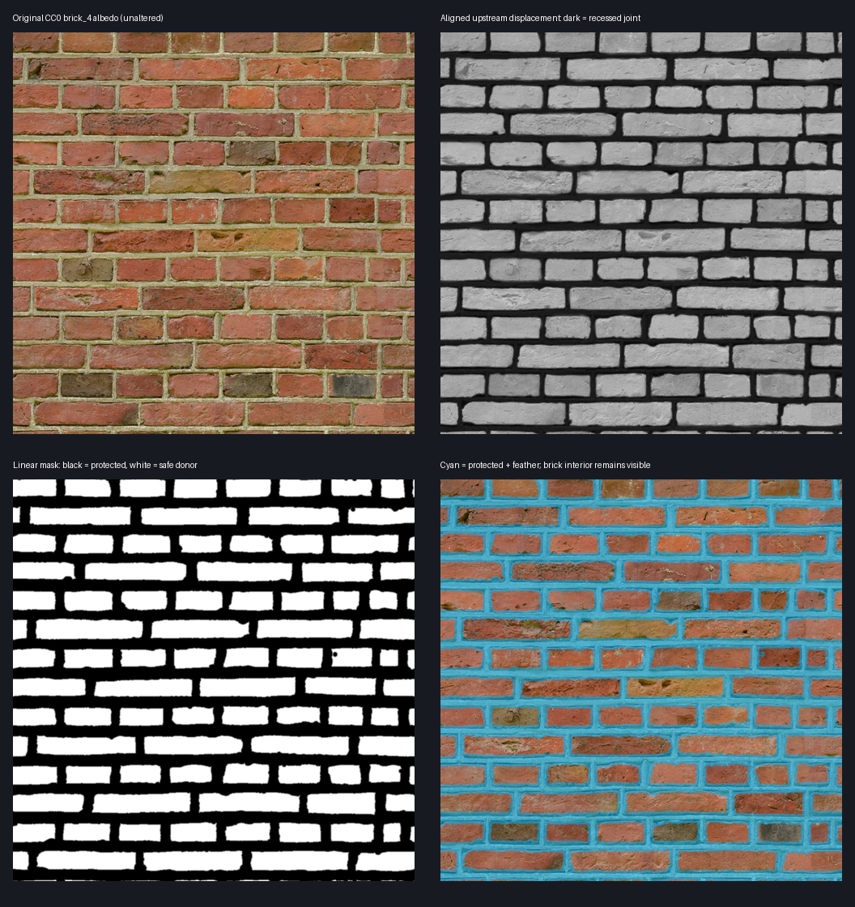

# Brick source interior mask

`assets/gallery/brick_4_interior_mask.png` is an aligned, single-channel linear weight: 0 protects the original source sample, 1 permits brick-interior variation. It is not a replacement albedo, normal, roughness, or displacement map. All existing PBR source files remain unmodified. The sampler must omit `source_color`; the import uses lossless compression and mipmaps, with automatic 3D compression disabled.

The existing measured `(2/15, 1/14)` half-stagger lattice only approximates this scan. Alternating rows contain different brick lengths, wandering joint widths, chipped corners and local offsets. Blending translated samples therefore overlaps shifted mortar even when the average row phase is correct. Protecting the original source mortar and rejecting donor mortar addresses the source of the double joints without redrawing the brick.

## Source and preprocessing

The matching **Brick 4** displacement by **Rob Tuytel**, obtained through the [Poly Haven files API](https://api.polyhaven.com/files/brick_4), is [CC0](https://polyhaven.com/license). The 1K PNG is an 8-bit luminance map, aligned at 1024 × 1024 with the gallery's albedo, normal and roughness. Direct inspection confirms dark recessed mortar and raised light brick interiors; roughness is not interpreted as height. Exact URLs, hashes, algorithm parameters and measured coverage are recorded in [source-mask.json](source-mask.json).

Regenerate from the repository root with Python plus Pillow, NumPy and SciPy:

```sh
python3 scripts/prepare_brick_mask.py
# Or use the exact upstream download offline:
python3 scripts/prepare_brick_mask.py --source /path/to/brick_4_disp_1k.png
```

The script checks the upstream MD5 before processing. Pixels with height ≤96 are unsafe. A Euclidean distance transform on a 3 × 3 periodic copy measures distance to unsafe pixels, then crops the center tile. Distance ≤3 pixels stays fully protected; distances from 3 to 8 pixels use cubic smoothstep; distance ≥8 is fully eligible. Quantization rounds to 8-bit PNG. This guard includes antialiased and chipped joint edges, and the periodic transform correctly handles bricks crossing the image boundary. It does not mirror or clamp the source edge.

The resulting mask has **40.54% exactly protected pixels**, **46.29% fully eligible interior**, and mean weight **52.67%**. Small recessed pits within bricks are also protected. This conservative loss of variation is intentional. The visual review below overlays protected and feathered pixels in cyan, alongside the original albedo, upstream height and resulting weight.



## Limits

The classification is specific to this scan; it is not automatic brick recognition or a general material mask. Its threshold is meaningful only for the verified 8-bit displacement. The height threshold intentionally favors false protection. No human segmentation ground truth or universal zero-miss guarantee is claimed. Inspecting the source-aligned overlay confirms protection of the visible irregular mortar network, including short and long bricks.

Shaders must guard both the original sample and each donor sample, use consistent weights for all PBR channels, and preserve the original sample when donor eligibility vanishes. Ordinary mipmaps average weights, so sufficiently distant samples mix mortar and brick; a guard implemented only with the coarsest mip cannot promise pixel-exact mortar protection. Any shader filtering policy and distant-view behavior need separate render validation.
