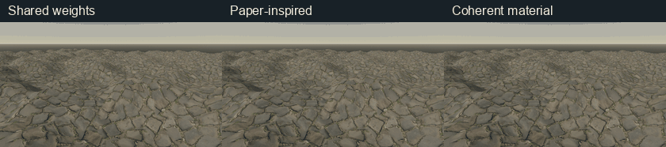
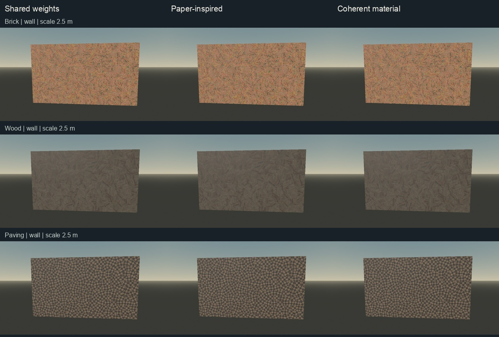
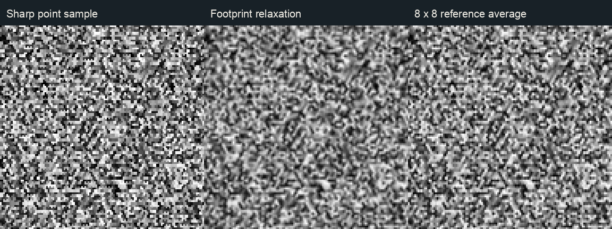

# Coherent material blending

This optional mode chooses one content-guided mixture for albedo, normal slopes, and roughness, then relaxes that mixture as the pixel footprint grows. It is a project-specific synthesis, not a claim of research novelty or a universal improvement. `coherent_blend` defaults to false. The original shared-weight mode remains the default and already preserves common map weights.



The loop compares the three modes along the same camera path. It is a visual inspection aid, not evidence of general temporal superiority. It contains 46 frames at 840 × 186 pixels (24 forward and 22 reverse, 85 ms per frame).

## Method and controls

Each triplanar projection reuses three transformed albedo samples and three normal samples. Candidate brightness and bounded normal relief guide a normalized barycentric mixture through a weighted geometric mean. `normal_strength` controls the normal cue's contribution; setting it to zero removes that cue. The resulting common weights blend color, normal slopes, and optional roughness. Roughness does not vote, because its value is not a general measure of feature importance. The normal is reconstructed from blended slopes.

The existing shared mode uses common geometric weights without this content guidance. Paper-inspired mode computes separate content weights per map, which can change relationships between blended features. Coherent mode takes precedence when both `coherent_blend` and `paper_blend` are true. The demo selector sets one mode at a time.

| Control | Coherent-mode behavior |
| --- | --- |
| `coherent_blend` | Enables this mode; false by default. |
| `coherent_filter` | Enables footprint relaxation; true by default, used only in coherent mode. |
| `paper_falloff` | Strength of content guidance, default 0.6. |
| `normal_strength` | Surface normal intensity and relative influence of normal relief on the common weights. |
| `blend_contrast` | Common weight curve, relaxed toward neutral at larger footprints. |
| `detile_blend_power` | Base barycentric exponent, relaxed toward one at larger footprints. |
| `normal_blend_contrast` | Ignored in coherent mode; remains a paper-mode control. |

For projection derivatives `dx` and `dy`, the footprint estimate is `f = max(length(dx), length(dy)) * 2 * sqrt(3)`. With filtering enabled, `detail = 1 - smoothstep(0.125, 0.5, f)`. As `detail` falls, the base exponent approaches 1, content guidance approaches 0, and blend contrast approaches 0.5. At large footprints the weights approach the geometric barycentric mixture. This is heuristic attenuation of the blend mask, not analytic integration of that mask or complete anti-aliasing. It can soften texture and does not address every source of motion shimmer.

Existing explicit-gradient texture sampling, cell offsets, rotations, and optional detrending remain in use. The mode needs no extra texture reads: full triplanar albedo/normal/roughness detiling has 27 source-level reads, or 18 with roughness disabled. Detrending adds 12 reads in either legacy or coherent paths. These source counts are not GPU timings; compiler optimization and hardware behavior matter.

## Seventeen-material gallery

The public demo contains the original nine sets and eight additional CC0 Poly Haven sets. The [source manifest](../../assets/gallery/SOURCES.json) and [expansion notes](../../assets/gallery/EXPANSION.md) record authors, exact downloads, verified hashes, map conventions, and substitutions. Cork was unavailable in the scanned catalog; Rubber Tiles provides another dielectric surface. Mossy Rock represents moss on stone. No metalness maps are used.

The [seventeen-material source palette](source-albedo-palette.png) shows source albedo images, **not shader renders**. Full source images are reduced to 208-pixel patches using Lanczos without color adjustment; [palette metadata](source-albedo-palette.json) records the exact names, paths, dimensions, and SHA-256 hashes.

[Fine-surface detail crops](finish-detail-crops.png) show plaster, leather, terrazzo, and rubber in all three shader modes at **one source pixel per sheet pixel**, without resampling or color adjustment. Each row uses the same crop rectangle across modes; [crop metadata](finish-detail-crops.json) records the rectangles. These crops make small differences easier to inspect but do not establish universal improvement.

Each contact sheet compares **shared / paper-inspired / coherent** modes with matched maps, camera, lighting, and mesh. The capture script records twenty cases: seventeen materials and three alternate views, for sixty JPG captures. Settings are rotation 0.65, blend contrast 0.65, normal strength 0.8, roughness maps enabled, coherent filtering enabled, and detrending disabled. The [capture metadata](capture-settings.json) records exact meshes, texture indices, repeat sizes, camera positions, and light settings. Captures use Godot 4.7.2 Compatibility on Apple M5.

| Comparison | What to inspect |
| --- | --- |
| [Organic surfaces](organic-comparison.jpg): boulder, sandstone, cobblestone | Subtle shifts in feature selection and contrast; recognizable features can still repeat. |
| [Ground and fabric](surface-comparison.jpg): rocks, grass, denim | Small appearance changes; blending may soften fine detail. |
| [Structured surfaces](structured-comparison.jpg): brick, wood, paving | Failure cases: random offsets and rotation still disrupt mortar lines, planks, and checker layouts. Shared mixtures do not reconstruct structure. |
| [Alternate views](angle-comparison.jpg) | View-dependent visibility of changes; these stills do not establish temporal stability. |
| [Snow, mud, and sand](terrain-comparison.jpg) | Pale, dark, and granular surfaces with different roughness cues. No separate snow subsurface or liquid model is implied. |
| [Plaster, terrazzo, and rubber](finish-comparison.jpg) | Fine and speckled surface detail; regular tile boundaries can still break. |
| [Leather and mossy rock](relief-comparison.jpg) | Wrinkled and irregular relief with the same map mixture. |



Appearance changes in these examples are often subtle. Content guidance does not preserve histograms, guarantee detail retention, reconstruct structured layouts, or remove every seam. Normal mapping remains the project's triplanar approximation rather than a general replacement for tangent-space mesh materials.

## Controlled checks

[`tests/coherent_probe.gd`](../../tests/coherent_probe.gd) exercises the production shader helpers on the GPU. The final run records **16 passing checks** in [validation.txt](validation.txt). Checks cover normalized weights, zero-support edges, candidate permutations, disabled normal guidance, extreme equal mixtures, flat normals, constant roughness, far-footprint relaxation, and footprint-transition continuity. These are targeted regressions, not proof for every input or renderer.

In an anti-correlated float fixture, each source texel has `albedo + roughness = 1`. The coherent mixture preserves that relationship with maximum recorded output error **0**, while independent paper-mode weights produce maximum error **0.345098**. Shared geometric weights also preserve such a relationship: this establishes the cost of independent weights in this fixture, not an advantage of coherent mode over the existing shared baseline.

A nonflat fixture ties normal slope to albedo and applies a controlled quarter-turn UV rotation. The expected common mixture and inverse normal rotation pass with maximum recorded error **0**. The fixture detects deliberate mutations: independent normal weights give error about **0.6**, and forward rather than inverse normal rotation gives error **1**. This demonstrates sensitivity to those regressions under the controlled fixture.

### Footprint isolation

[`tests/coherent_footprint.gd`](../../tests/coherent_footprint.gd) isolates the procedural weights using one grayscale random-vertex field, seed 0. It compares point weights and relaxed weights against an 8 × 8 supersampled reference. This is a single static synthetic field, separate from PBR texture quality or a general temporal evaluation. Full precision results are in [footprint-results.json](footprint-results.json).

| Field scale | Lattice units / pixel | Point RMSE | Relaxed RMSE |
| --- | --- | --- | --- |
| 2 | 0.054127 | 0.003937 | 0.003937 |
| 8 | 0.216506 | 0.036296 | 0.028587 |
| 20 | 0.541266 | 0.090850 | 0.054711 |



Relaxation reduces error for the two larger footprints in this field and leaves the near footprint unchanged. It does not establish improvement across seeds, textures, camera trajectories, or lighting. Source-texture mipmapping and nonlinear shading can introduce other errors.

## Performance

The final November 3 run records median process-frame intervals of **3.276–3.295 ms shared**, **3.325–3.343 ms paper-inspired**, and **3.089–3.100 ms coherent**. It uses nine alternating rounds at 1280 × 720, 180 warm-up frames and 600 measured frames per round. See the [benchmark notes](../../benchmarks/README.md) and [raw mode comparison](../../benchmarks/apple-m5-coherent-compare.txt). They measure whole-scene process-frame intervals rather than isolated GPU shader time. The renderer reports zero GPU timing samples, so close frame intervals or a shorter interval cannot establish a general GPU speedup.

## Reproduce

Copy the entire add-on folder, including `hex_detile.gdshader` and its required `coherent_blend.gdshaderinc`. Import assets first. Run GPU scripts on a graphics display; headless rendering does not validate these GPU fixtures.

```sh
godot --headless --editor --path . --import
godot --headless --path . --script res://tests/smoke.gd
godot --path . --resolution 1280x720 --script res://tests/gpu_probe.gd
godot --path . --script res://tests/coherent_probe.gd
godot --path . --script res://tests/coherent_footprint.gd
godot --path . --resolution 960x540 --script res://tests/coherent_gallery.gd
HEX_CAPTURE_DIR=/tmp/hex-coherent-motion godot --path . --rendering-method gl_compatibility --resolution 720x406 --script res://tests/coherent_motion.gd
HEX_CAPTURE_DIR=/tmp/hex-coherent-motion python3 tests/coherent_media.py
godot --path . --resolution 1280x720 --disable-vsync --max-fps 0 --script res://benchmarks/coherent_compare.gd
```

[`tests/coherent_media.py`](../../tests/coherent_media.py) assembles contact sheets and the camera loop from the capture outputs; inspect its input paths before regenerating. Captures are evidence tied to these settings, not a substitute for checking the material in the target project.

## Background and scope

Morten S. Mikkelsen's [Practical Real-Time Hex-Tiling](https://jcgt.org/published/0011/03/05/) (2022) provides the main basis for this project's stochastic tiling adaptation. Thomas Deliot and Eric Heitz's [Procedural Stochastic Textures by Tiling and Blending](https://eheitzresearch.wordpress.com/738-2/) provides broader background, including histogram transformations and prefiltering; those preprocessing methods are not implemented here.

Bartlomiej Wronski's [GPU-Friendly Laplacian Texture Blending](https://jcgt.org/published/0014/01/02/) (2025) is a distinct multiband approach. This coherent mode does not implement it. The repository's [two-band experiment](../../experiments/two_band/) remains separate and unshipped. Combining existing PBR content cues with heuristic footprint relaxation here is an engineering choice evaluated with bounded fixtures and matched captures, not a new research result.
