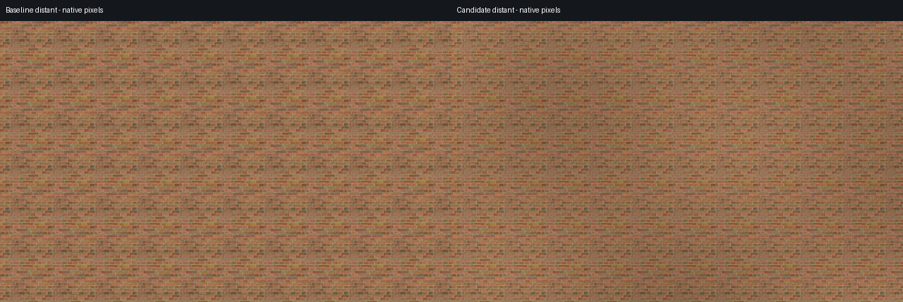
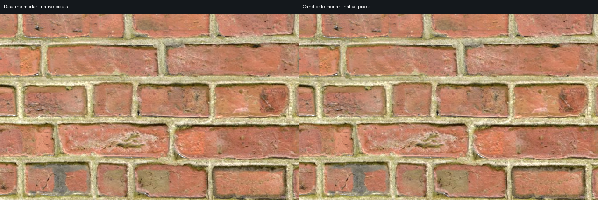

# Distant brick variation: partial improvement, insufficient overall

This local experiment reduces a measured component of repeated broad color, but the source's colored patches and irregular joint shapes remain visibly repeated. It **does not meet the predeclared overall repetition target**. Keep it default off on `codex/distant-brick-variation`; it is not merged, published or included in the v0.7.0 addon archive.

In the project demo, select **Brick 4**, enable **Preserve pattern** and **Protect mortar**, then check **Vary distant brick tones · experiment**. Detiling must be on. Unchecking restores the v0.7.0 packed brick; disabling detiling restores the original JPEG. Other materials remain ineligible and the preference persists.

## What changed

A separate albedo copy removes some broad luminance variation with a wrapped Gaussian lowpass (sigma 64 source pixels), bounded scalar gain and strength 0.65. Pixel positions and guard alpha are unchanged; the original images are untouched. Actual final gain is 0.8821–1.0685, including a global highlight-headroom factor; mean source luminance decreases about 4.2%. See [normalization method, provenance and audit](NORMALIZATION.md).

A smooth world-anchored scalar field adds modest broad tone after material sampling, consistently across reference/donor mixtures and source-only early returns. Three directional waves use deterministic variation-seed phases and a default amplitude of 0.18 stops, bounded by approximately 0.883–1.133 gain. Each sine is filtered over its derivative-defined pixel footprint before the final exponential gain; this is not an exact integral of the final gain or a universal aliasing guarantee. The field does not repeat with each source tile, but the finite wave construction is not mathematically aperiodic.

The mortar mask, fade cutoff, source-only optimization, normal/roughness source maps and sample positions are unchanged. Normalized color can change coherent brightness votes and therefore interior PBR mixture weights; those outputs are not promised identical. The macro multiplier itself changes only final albedo. Original protected RGB is deliberately adjusted in tone in this experiment, while joint positions remain unchanged.

## Distance comparison

Left is frozen v0.7.0; right is normalization plus macro. These are native 640 × 400 crops with no rescaling in the stored comparison. Broad tones look flatter, but repeated patches are still readily recognizable.

The evaluation uses an unlit flat orthographic wall at 1280 × 720, seeds 0 and 7, with known full-source displacement projected from world coordinates. “Distant” here is a 30 m view height and 60-pixel source repeat; the intermediate view height is 7.5 m with a 240-pixel repeat. Perspective PBR examples separately use a camera about 32 m from the wall. Linear luminance is blurred below brick-pitch detail, and Fourier energy measures source harmonics 1–6. Energy is normalized by squared mean brightness so simply darkening the material does not earn credit.

| Distant result vs baseline | Seed 0 | Seed 7 |
| --- | ---: | ---: |
| Selected periodic color energy, combined | −50.8% | −51.0% |
| Full-source autocorrelation, combined | −12.3% | −11.4% |
| Mean luminance, combined | −3.2% | −4.0% |

The target required at least 25% less periodic energy **and** 20% less full-source autocorrelation for both distant seeds. The energy criterion passes; the correlation criterion fails. This is not “51% less visible tiling.” Normalization alone produces almost the same energy reduction, but only 0.18% less autocorrelation: it flattens the repeated tones while largely retaining their arrangement. Macro alone barely changes periodic energy and mainly adds a broader field over the same source pattern.

At the intermediate view, neither seed increases periodic energy, but the combined seed-7 mean luminance decreases **10.008%**, narrowly outside the declared 10% brightness tolerance. This reinforces keeping the result experimental rather than treating all checks as successful. No sampled unlit metric image has a channel at 255, although isolated bright source values can theoretically exceed unit range under the maximum macro gain.

See [four arms, distant seed 0](four-arms-30.0-seed0.png), [seed 7](four-arms-30.0-seed7.png), [intermediate seed 0](four-arms-7.5-seed0.png), [seed 7](four-arms-7.5-seed7.png), [raw metrics](metrics.json), and [criteria declared before captures](CRITERIA.md). The four arms are original, normalization alone, macro alone and both; no failed seed or view is dropped.

## Mortar and material channels

The native close comparison retains visibly sharp mortar, with modest tone differences:

Across 243 sampled edge neighborhoods per seed (±16 pixels around mask-0.5 crossings), the maximum-gradient location has median displacement zero pixels and 95th percentile one pixel. The gradient-second-moment width proxy changes by less than 0.1% at the median; this is not a physical mortar-width measurement. Median local contrast decreases 0.6% / 2.5%; the fifth-percentile ratios are 0.947 / 0.916, within the 10% contrast-loss target. These are sampled image proxies, not proof that every mortar feature is unchanged.

Protected normal/roughness readbacks differ by at most one RGBA8 byte in close/grazing views; source-only distant outputs have zero observed difference. Interior normal/roughness mixtures also show up to one byte difference because normalized brightness can steer coherent weights. Guard alpha is byte-identical, but that fact alone does not establish visual quality. Inspect [seed 7 close mortar](close-mortar-native-seed7.png), [grazing PBR](pbr-grazing-seed0.png) and [distant PBR](pbr-distant-seed0.png) as well.

## Motion and controls

The tester captured 64 matched camera poses at 640 × 360: 16 logarithmic approach/retreat poses and 16 wall-pan poses for each of seeds 0 and 7, with baseline and candidate at each pose. View [actual approach motion, seed 0](approach-seed0-motion.gif) and [wall pan, seed 7](pan-seed7-motion.gif). Raw moving-camera differences are not treated as flicker measurements.

A GPU probe evaluates the actual production field at 16,384 fixed world points, changing only the derivatives through 16 approach footprints per seed. The largest adjacent gain change is 1/510, one quantum of the amplified RGBA8 readback. This supports a world-stationary, smoothly filtered macro field within the sampled range; it is not a whole-material flicker error bound or proof against every source-texture mip transition. The shader has no time, screen or camera-dependent phase.

With the original packed asset, both disabled macro and enabled macro at strength zero match the frozen v0.7.0 framebuffer with zero observed byte difference in the captured control. All nine fresh regression scripts pass. See the [complete validation and reproduction](VALIDATION.md), [controls](controls.json), [world-field probe](world-stability.json), [camera poses](motion-settings.json) and [regression record](regressions.json). The quality target still fails; passing controls does not turn that into a successful tiling remedy.

The next stronger approach would need region-aware per-brick appearance replacement, a larger exemplar, or a different authored layout. This modest tone experiment cannot remove repeated unique joint geometry. The earlier [two-band donor-blending prototype](../../experiments/two_band/README.md) likewise did not establish an improvement; it is not used here.
