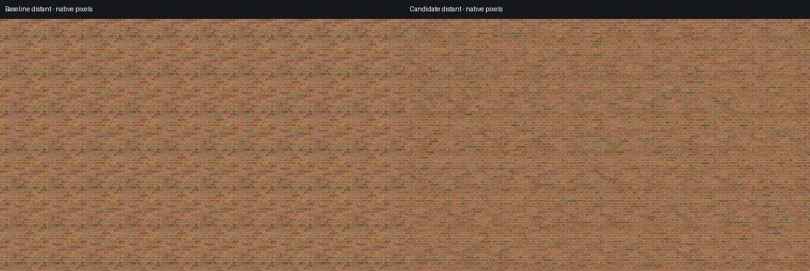
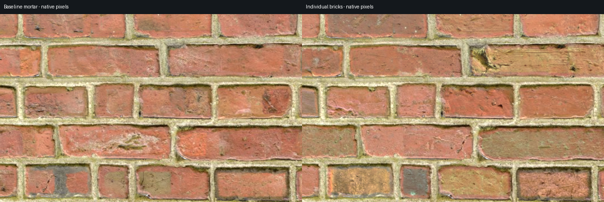

# Individual brick color experiment

Current status: the accepted 4×4 Brick 4 mode is packaged with v0.8.0. [Current settings, qualification results, memory/rendering costs and source examples](../brick_atlas_release/README.md) supersede the original local-branch status below; the measurements and initial failed linear blend remain historical evidence.

**This reduces the repeating colored patches much more than the previous macro-tone experiment.** Source-repeat color correlation fell **56.7% / 59.2%** in the two distant seed cases, while the inspected mortar lines stayed aligned and sharp. Original joint shapes, fine marks and some dark protected rims still repeat. The retained mode is opt-in, with a substantial cost: **about 85.3 MiB per atlas including mipmaps**, versus 5.3 MiB for the source texture. Those are theoretical uncompressed RGBA8 texel storage sizes, not measured allocation, VRAM or process memory.

Left: original v0.7.0. Right: individual brick variation. The stored comparison uses native pixels without resizing.

[Seed 7](distant-native-seed7.png) · [Four arms: original, previous macro, direct atlas, aligned stochastic atlas](four-arms-native-30.0-seed0.png) · [Intermediate view](four-arms-native-7.5-seed0.png)

## What improved

The preprocessing identifies actual irregular brick interiors, removes their broad original RGB color identity, and assigns plausible colors drawn from the source bricks. It preserves original pixel positions and protected mortar RGB. Smoothly blending three atlas samples at integer source-tile offsets varies the palette across the wall while keeping every sample's mortar and fine-detail geometry in phase. This is not another broad noise overlay.

The final candidate meets the declared distant repetition and palette-variance targets in both tested seeds:

| Measure versus original | Seed 0 | Seed 7 |
| --- | ---: | ---: |
| Selected periodic chromatic energy reduction | 79.2% | 80.9% |
| Source-repeat color correlation reduction | 56.7% | 59.2% |
| Source-repeat luminance correlation reduction | 43.1% | 49.8% |
| Between-brick RGB variance retained | 58.0% | 59.3% |
| Mean luminance change | −1.9% | −2.0% |

Color correlation averages the x/y correlations of linear R−G and B−G channels at the known source repeat. These are image measurements, not percentages of perceived tiling removed. Energy is normalized by mean brightness squared so darkening earns no credit; the variance check guards against making every brick gray.

The previous normalization-plus-macro arm reduced source-repeat color correlation only about 11% here. Directly sampling the recolored atlas does better at that original repeat, but simply repeats its new layout every four source spans: 10 m at the tested 2.5 m scale. Its correlation at that larger repeat is about **0.991**. The primary stochastic variant lowers that to **0.447 / 0.407**, so its improvement is not solely a larger repeating image. It still uses a finite palette and repeated source geometry; it is not an infinite aperiodic brick material.

An initial linear blend retained only 47.1% / 48.2% of the original between-brick variance, failing the declared 50% minimum. One recorded adjustment—squared, normalized blend weights—produced the final result above. The [initial evidence](linear-weights/metrics.json), [unchanged criteria](CRITERIA.md) and [final metrics](metrics.json) remain inspectable.

## Mortar and close detail

All **6,801,920 protected native atlas pixels per seed** retain exact original RGB, and alpha is unchanged. In close/grazing rendered comparisons, protected mortar RGB differs by at most **1/255**; protected normal and roughness readbacks match exactly. Distant normal/roughness also match across the whole image. The new mode uses original, aligned source PBR instead of the old coherent donor mixtures, so near brick interiors intentionally change. [Seed 7 mortar](close-mortar-native-seed7.png) and [grazing PBR](pbr-grazing-seed0.png) show that tradeoff.

Sampled edge-profile medians retain their location and similar width, but the tails matter. The strongest-gradient proxy can move 26–30 pixels to a different interior or corner feature; this is not a measured joint displacement. The worst local contrast ratios are about **0.46–0.48**, despite median ratios near 1.0. Reviewed crops keep the joint lines aligned and sharp, while nearby brick tones/details change substantially. Inspect the [worst peak-switch crop](edge-tail-peak-shift-seed0.png), [worst contrast-loss crop](edge-tail-contrast-loss-seed7.png) and [profile audit](edge-tail-review.json). Original dark or colored protected rims can remain against recolored interiors; exact copied pixels do not guarantee an equally natural appearance everywhere.

## Motion, activation and limits

The tester captured 64 matched approach/pan camera poses across both seeds. View [approach, seed 0](approach-seed0-motion.gif) and [pan, seed 7](pan-seed7-motion.gif). Fixed-world footprint, mip/fade and triangle-boundary probes pass their declared tolerances. This is bounded stability evidence, not a universal alias-free guarantee or a flicker measurement from raw moving-camera differences. All ten regressions pass; disabling this option reproduces the appropriate frozen original or previous-macro control with zero observed framebuffer byte difference.

In the project demo, select **Brick 4**, enable **Preserve pattern** and **Protect mortar**, keep detiling on, then check **Vary individual brick colors**. This temporarily disables the earlier macro option and restores its preference when unchecked. The demo binds baked palette 0; the harness manually binds palette 7 for the second test case. The usual variation seed changes the stochastic world layout. Other materials remain ineligible.

The full-resolution 4×4 atlas keeps source detail and costs no runtime region-ID decoding, but is memory-heavy. Two atlas textures contain about 170.7 MiB of uncompressed texels. Binding one does not establish how many resources remain resident; actual allocation was not measured. Smooth palette transitions can also create tonal gradients within a brick. The primary route uses 15 source-level full-PBR reads when resolved, at most 16 with its shared coarse mean; direct-atlas ablation uses nine. These counts are not a performance benchmark. Coarse color fades to the atlas mean rather than restoring the old repeating colors. Original modes and assets remain unchanged when the experiment is off.

This historical record originated on `codex/individual-brick-variation`; the accepted 4×4 mode is retained in the v0.8.0 package. Current release settings and failed compact/source trials are documented in the [release guide](../brick_atlas_release/README.md). See [preprocessing and provenance](PREPROCESSING.md) and [complete validation and reproduction](VALIDATION.md) for implementation details, all comparisons, units and limits.
