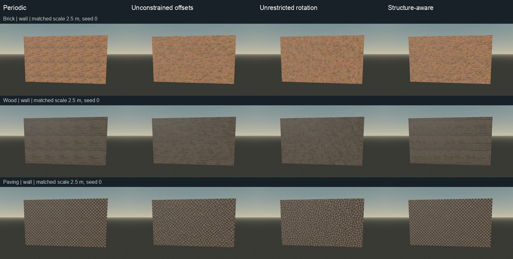
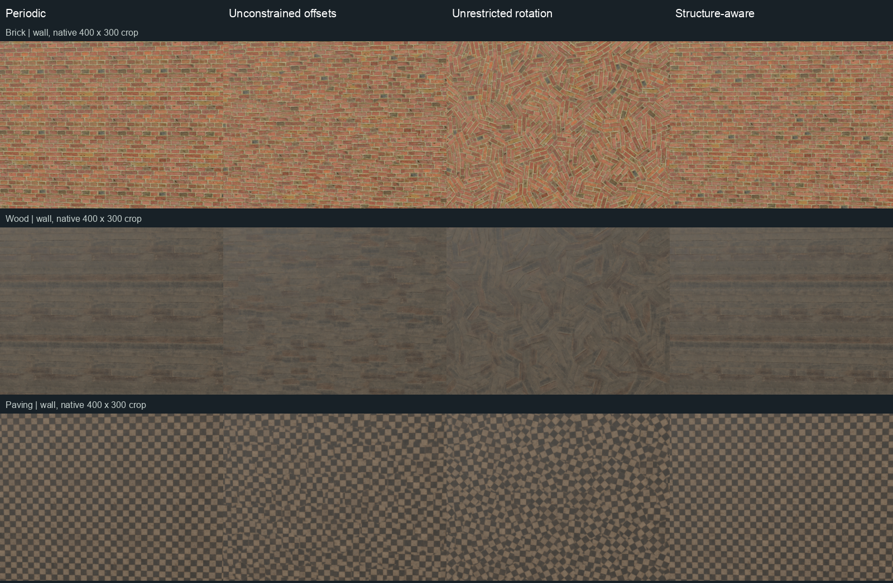

# Optional structure-aware transforms

`structure_enabled` constrains the stochastic transforms to a user-supplied source lattice. It defaults to `false` and is independent of shared, paper-inspired, and coherent blending. This is a source-specific transform constraint; it does not recognize patterns or generate new material content.

When enabled, rotation is identity even if `rotation_strength` is nonzero. The same deterministic cell hash selects two integers in `[-4,4]`. All maps use the translation

```
ix * (structure_period.x, 0)
+ iy * (structure_stagger * structure_period.x, structure_period.y)
```

Periods are measured in source UV: `1` is one complete source image repeat. A zero period component locks that coordinate. Stagger is a fraction of the X period per Y step, typically `0.5` for running-bond brick. Translations change sample positions without changing texture derivatives or adding texture reads. This setting does not change blend weighting, filtering, detrending, or world-space projection.

## Choosing a lattice

Choose steps that preserve the source's intended motif, including its color parity. Checker paving needs two-square axis steps rather than a single square; a one-square step swaps light and dark. Planks can lock the coordinate across the boards while shifting along the boards. Full-source-image steps sample the same repeating image, so a period of `(1,1)` with zero stagger gives no meaningful variation. The blend modes can still alter the result when using their other optional settings.

Run the demo and choose **Brick 4**, **Dark Wooden Planks**, or **Checkered Pavement Tiles** from the material selector (indices 3, 4, and 7 in `demo.gd`). Enable **Preserve pattern**; use the main detiling toggle to compare against periodic sampling. The blend selector remains independent. The demo's **Preserve pattern** option is available for these three materials. Its label identifies the approximate source-specific preset; changing to an unsupported source switches the option off and disables it. Changing among supported sources applies the corresponding preset. Rotation is disabled in the panel while preservation is active. For another source, select its ShaderMaterial in the Inspector, enable `structure_enabled`, and enter a matching `structure_period` and `structure_stagger`. Start with one axis locked if only one direction has a reliable repeat. These settings operate on source UV before `texture_scale_m` places the image in world space.

| Demo source | `structure_period` | `structure_stagger` | Constraint |
| --- | --- | --- | --- |
| Brick 4 | `(2/15, 1/14)` | `0.5` | Approximate brick pitch and half-brick row stagger. |
| Dark Wooden Planks | `(0.25, 0)` | `0` | Quarter-source shifts along boards; lock the transverse coordinate. |
| Checkered Pavement Tiles | `(0.2, 0.2)` | `0` | Approximate two-square shifts, preserving checker color parity. |

These values were measured from the bundled 1024-pixel maps, not inferred at runtime. Brick's horizontal period is a fractional source repeat: `7.5 * (2/15) = 1`, so no integer number of brick steps exactly spans the wrapped source width. Scanned mortar lines, plank seams, and paving edges are irregular as well. The source maps must have true periodicity on the supplied lattice for full alignment. A matching ideal lattice preserves phase; an approximate scanned lattice can still show doubled edges or blended seams. Test each source and reduce the allowed variation by locking an axis if needed.

Triplanar projection applies the constraint separately to each projection plane. It cannot enforce a single architectural layout around corners or across arbitrary geometry. This mode retains the existing sample cost, softening, and content-weighting tradeoffs; it is not a substitute for mesh UVs or an explicitly modeled surface layout where exact alignment is required.

## Evidence and reproduction

The matched GPU gallery compares **periodic**, **unconstrained offsets with rotation zero**, **unrestricted rotation at strength 1**, and **structure-aware** sampling. All four use the same camera, maps, coherent blend mode, seed 0, 2.5 m texture repeat, roughness map, normal strength 0.8, and blend contrast 0.65. Structure mode uses identity rotation; these comparisons do not imply one blend mode is superior. [Exact capture settings](capture-settings.json) include the three cameras and preset values.



The checker grid and long horizontal plank seams are more intact than with unconstrained offsets, including at rotation zero. Brick courses remain recognizable, but irregular joints still soften or double relative to periodic sampling. Wood end joints and broad tonal patches still change. Periodic sampling retains the original layout most faithfully and also retains its source repetition; preserving structure does not remove every repeating motif. These are three source materials and fixed settings, not a general quality guarantee.



The detail sheet uses identical 400 × 300 native pixel crops with no resizing inside each panel; [crop settings](crop-settings.json) record their source positions. Additional matched views: [oblique wall](oblique-comparison.jpg) and [elevated terrain](elevated-comparison.jpg). These show the limits of the approximate scanned lattices and of applying structured materials over triplanar geometry.

The display-backed fixture run in [probe.log](probe.log) passed 24 checks on Godot 4.7.2 Compatibility / Apple M5: analytic brick phase, checker parity, locked board axis, identity normal orientation, sampled structure in shared/paper/coherent paths, microvariation in shared/paper paths, coherent color/roughness alignment, support boundaries, seed/reset behavior, full-repeat degeneration, finite transforms at zero/small/large periods, a zero-shift negative control, and comparison of disabled transforms and sampled output to commit `5b86dca`. Synthetic phase checks establish the supplied lattice behavior; they do not prove real scanned materials perfectly align. [Source calibration](analysis/README.md) explains the measured periods separately from shader output.

After importing the project, run on a graphics display:

```sh
godot --path . --rendering-method gl_compatibility --script res://tests/structure_probe.gd
godot --path . --rendering-method gl_compatibility --resolution 960x540 --disable-vsync --script res://tests/structure_gallery.gd
python3 tests/structure_media.py
```

The [UI smoke check](ui-smoke.log) passed preset switching, rotation locking, unsupported-source reset, and opt-in defaults. Existing [scene smoke](smoke.log), [flat-normal GPU](gpu-probe.log), and [coherent alignment](coherent-probe.log) checks also passed.

The baseline comparison in the probe is optional when `/tmp/hex-structure-baseline.gdshader` is unavailable. To reproduce it, export the original shader before running the probe:

```sh
git show 5b86dca:addons/hex_detile/hex_detile.gdshader > /tmp/hex-structure-baseline.gdshader
```

Headless parsing alone does not validate GPU behavior. No benchmark was run for this option; unchanged source-level read counts do not establish identical runtime performance.
